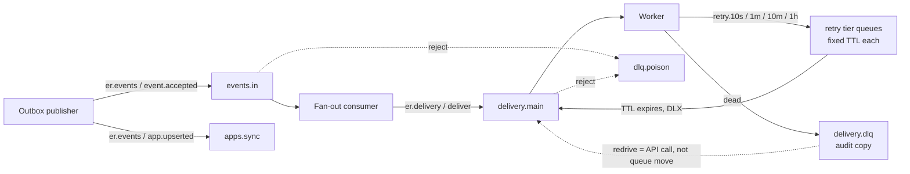
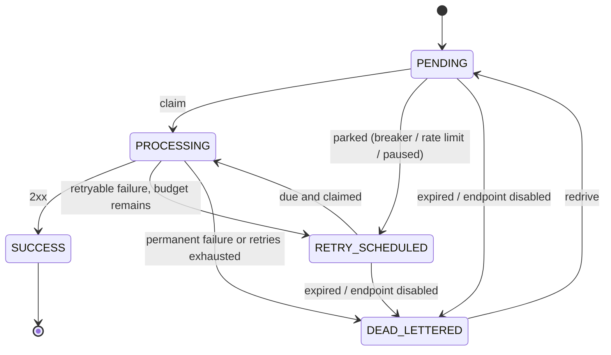
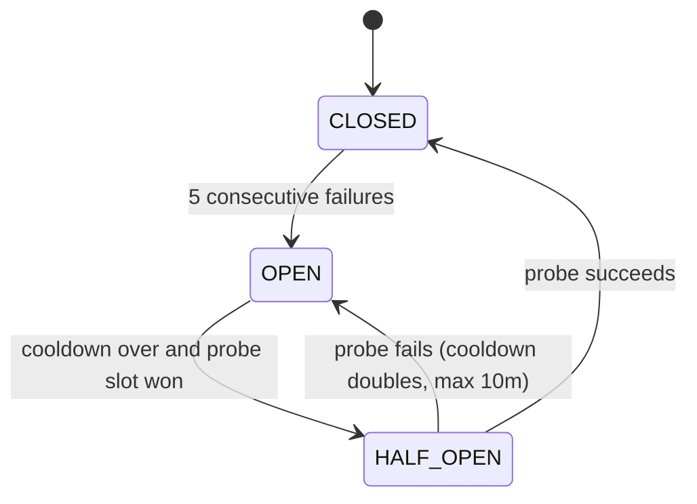

# EventRelay — End-to-End Flow Master Document

**Version:** 0.6 (supersedes 0.5)
**Status:** Core architecture decisions resolved; remaining decisions are tracked in "Decisions still unresolved". This file is the behavioral source of truth; the schema/API contract and the phase plan derive from it.
**Companion files:** `eventrelay-database-and-api-contract.md`, `eventrelay-granular-implementation-phases.md`

### What changed from v0.1

| # | Change | Why |
|---|---|---|
| 1 | Every open decision is resolved (Section 0) | v0.1 left ~16 questions open; code would have decided them by accident |
| 2 | One terminal failure state, `DEAD_LETTERED`, with a `dead_reason`; `FAILED`/`EXHAUSTED`/`CANCELED` removed | State machine and RabbitMQ diagram contradicted each other |
| 3 | Delivery Service now has an explicit durable handoff: fan-out commit, then publish `DeliverWebhook` with confirms, then ACK the inbound message | v0.1 left "DB polling vs RabbitMQ" open, which hid a second dual-write gap |
| 4 | Tiered retry queues (10s/1m/10m/1h) | A single TTL queue blocks short delays behind long ones |
| 5 | Auth split: API key only for event ingestion/read; JWT (RS256) for all management | Delivery Service cannot validate API keys stored in Event Service's DB |
| 6 | `redrive_count`, per-cycle `attempt_count`, and lifetime `total_attempts` | Replay on the same delivery ID had an undefined retry budget |
| 7 | One `event_copy` row per event in Delivery Service, referenced by deliveries | v0.1 copied the payload into every delivery row |
| 8 | Outbox claim uses a short lease transaction, not a transaction held open during publish | Never hold a DB transaction across network I/O |
| 9 | Reconciler (repair job) added | Covers lost signals, expired leases, and redeliveries dropped while a lease was active |
| 10 | Stack fixed: Java 21 + Spring Boot 3; Redis for rate limits and breaker state | Phases depend on it |

### What changed in v0.6 (two targeted fixes, all three files)

| # | Change | Where |
|---|---|---|
| 1 | **Stranding bug fixed:** every pre-claim transition (dead-letter, park) now uses the single *claimable* predicate, which includes `PROCESSING` rows whose lease has expired. Previously a crashed worker's row plus a now-disabled/paused/expired condition got zero rows from the guard, the signal was dropped, and the reconciler re-signalled it forever | D28, Flow D (D2, Parking), contract 3.5 |
| 2 | **Disabled-app rule:** `EventAccepted` for a `DISABLED` app keeps the `event_copy`, creates no deliveries, and ACKs; a missing `apps_ref` row counts as `ACTIVE`; existing deliveries are unaffected | D33, Flow C |
| 3 | Crash-window tests 30–31 | Section 18, Phase 25 |

### What changed in v0.5 (coordinated across all three files)

| # | Change | Where |
|---|---|---|
| 1 | Every state change made *before* the claim (dead-letter, park) is a conditional `UPDATE`; history rows, audit copies and tier publishes happen only if exactly one row changed. Duplicate concurrent signals can no longer double-park or rewrite `next_retry_at` | D28, Flow D (D2, Parking) |
| 2 | Redrive transition fully specified (which fields are cleared, which are preserved) | D30, Flow F1 |
| 3 | Lease-takeover history: same-status `PROCESSING → PROCESSING` rows with reason `LEASE_EXPIRED`, written by the taker (not the reconciler) | D29, Flow D5, Section 16 |
| 4 | Explicit nginx routing table for the overlapping `/v1/apps/...` and `/v1/events/...` paths | D31, contract 7.0 |
| 5 | `deliveries.webhook_id` column decouples the header value from the event ID, so the replay-identity decision becomes a one-line change | D22, D32 |
| 6 | Retry timing is documented as inexact (Retry-After rounds up to a tier); maximum-delay test added | D10, Phase 17 |
| 7 | Phase 00 seeds D1–D32 with pending ones marked; status header reworded | Phase 00, header |
| 8 | Crash-window tests 26–29 | Section 18, Phase 25 |

### What changed in v0.4 (coordinated across all three files)

| # | Change | Where |
|---|---|---|
| 1 | Idempotency `ON CONFLICT` repeats the partial-index predicate (`WHERE idempotency_key IS NOT NULL`) so PostgreSQL can infer the index; tested against real PostgreSQL | Flow A, contract 2.4, Phase 05 |
| 2 | Resuming an endpoint now sets `next_retry_at = now()` for its `ENDPOINT_PAUSED` deliveries and publishes wake-up signals (a bare signal would be "not due" under the claim predicate) | Flow F4, Phase 16 |
| 3 | Fan-out selection uses `EXISTS` so an endpoint subscribed to both the exact type and `*` yields one row | Flow C, contract 3.3, Phase 15 |
| 4 | Two distinct operations: a *new park/retry* writes `next_retry_at`; *re-publishing an early signal* never changes it, so repeated early signals cannot push the schedule later | D10, Flow D (D2.2) |
| 5 | Health API returns the projection as a nested `projection` object (one naming convention), D26 updated | D26, contract 7.2, Phase 22 |
| 6 | Crash-window tests 22–25 added | Section 18, Phase 25 |

### What changed in v0.3 (coordinated across all three files)

| # | Change | Where |
|---|---|---|
| 1 | Fan-out selects `ACTIVE` **and** `PAUSED` endpoints (never `DISABLED`); the exact predicate is specified | Flow C, contract 3.3 |
| 2 | The claim statement itself enforces `next_retry_at <= now()` for `RETRY_SCHEDULED`; the 2-second tolerance is removed; parking sets `next_retry_at = now + tier TTL` | D10, Flow D (D2.2, D5) |
| 3 | `application_id` → `app_id` in the idempotency SQL, D5 and the idempotency table | Flow A, D5, Section 12 |
| 4 | ID representation made explicit: UUID in DB, raw UUID in messages/JWT/logs, prefixed only at the public API, with conversion tests | D3, contract Section 1 |
| 5 | DLQ audit copies are **best-effort**; the database stays authoritative; a failed audit publish never blocks ACK | D12, D25, Flow D9, matrix |
| 6 | Phase 09 temporary REST link is dev-only, best-effort, unrecoverable until Phase 14 | D27, phases 09/14 |
| 7 | UUIDv7 generation strategy for Java 21 | D24 |
| 8 | `endpoint_health` is a lagging projection; the health API returns live Redis state with an explicit source field | D26, contract 3.8/7.2 |
| 9 | New crash-window tests 18–21 and the matching phase acceptance criteria | Section 18, phases |

### Decisions still unresolved after v0.3

1. **Replay reuses `webhook-id`** (D22): kept as designed, so deduplicating receivers will ignore replays. Needs your explicit confirmation; if you want replays to be re-processed, give replays a new `webhook-id`.
2. **UUIDv7 library API:** D24 names `uuid-creator`; verify the exact method name for the version you pin in Phase 02 and record it in `docs/decisions.md`.
3. **Durable DLQ audit** (via outbox) is deferred. Revisit only if audit copies become a requirement.
4. **JWT public-key distribution/rotation** (file vs environment, how keys roll) is not specified yet; decide in Phase 20.
5. **Wildcard subscriptions** beyond a single `*` stay out of scope.

---

## 0. Resolved decisions

| ID | Decision |
|---|---|
| D1 | **Stack:** Java 21, Spring Boot 3, Maven, Spring AMQP, `JdbcClient` + Flyway (no JPA, because `SKIP LOCKED`/lease SQL is clearer in plain SQL), Spring Data Redis with Lua scripts, Apache HttpClient 5 for outbound webhooks, Micrometer + OpenTelemetry, JUnit 5 + Testcontainers. |
| D2 | **Databases:** one PostgreSQL instance, two databases (`eventrelay_event`, `eventrelay_delivery`), separate credentials. No cross-database queries or foreign keys. |
| D3 | **IDs:** UUIDs everywhere inside the system: database columns are `uuid`; internal RabbitMQ messages, JWT `sub`, logs and metrics carry the raw canonical lowercase hyphenated UUID. **Only the public API** uses prefixed forms: prefix + `_` + the same UUID (`evt_`, `del_`, `ep_`, `app_`, `key_`), e.g. `evt_018f6b3e-8a2c-7c10-9d4e-5b2a1f0c9e11`. Conversion happens in exactly one place at the HTTP boundary. A path ID with the wrong prefix or an invalid UUID → `404` (no information leak); the same in a body or query parameter → `422`. |
| D4 | **Auth:** API key (`Authorization: Bearer er_<prefix>_<secret>`) is accepted **only** on `POST /v1/events`, `GET /v1/events*`. Everything else (apps, API keys, endpoints, deliveries, replay) uses a JWT (RS256, signed by Event Service, verified by Delivery Service with the public key). Roles: `ADMIN`, `DEVELOPER`. |
| D5 | **Idempotency:** `Idempotency-Key` header is optional. Scope = `(app_id, key)`. Retention = event retention (30 days). Same key + same request → original result with `Idempotent-Replayed: true`; same key + different request → `409`. No key means no dedupe (documented). |
| D6 | **Fan-out owner:** Delivery Service. The `EventAccepted` message carries the immutable event envelope (payload ≤ 256 KB). Delivery Service stores it once in `event_copy`. |
| D7 | **Delivery states:** `PENDING`, `PROCESSING`, `RETRY_SCHEDULED`, `SUCCESS`, `DEAD_LETTERED`. `dead_reason`: `RETRIES_EXHAUSTED`, `PERMANENT_FAILURE`, `EXPIRED`, `ENDPOINT_DISABLED`. |
| D8 | **Attempt counting:** `max_attempts = 6`, counting the first HTTP request. `attempt_count` = attempts in the current cycle (reset on redrive). `total_attempts` = lifetime, used for `attempt_no`. Breaker skips, rate-limit parks and paused-endpoint parks do **not** consume an attempt. |
| D9 | **HTTP classification:** 2xx = success. **Permanent:** `SSRF_BLOCKED`, invalid URL/scheme, HTTP 410. **Retryable and trips breaker:** timeout, connection error, TLS error, 5xx, 408, 429. **Retryable, does not trip breaker:** 3xx (redirects are never followed) and other 4xx (customers fix 401/404 later). `Retry-After` on 429/503 picks the next tier ≥ the hint, capped at 1h. |
| D10 | **Retry mechanism:** RabbitMQ tiered TTL queues `retry.10s`, `retry.1m`, `retry.10m`, `retry.1h`, each with a fixed `x-message-ttl` and DLX back to `delivery.main`. Attempt-to-tier: after attempt 1 → 10s, 2 → 1m, 3 → 10m, 4 → 1h, 5 → 1h, attempt 6 failing → dead. The DB row is authoritative; the retry message is only a wake-up signal. **Every park or retry sets `next_retry_at = now() + <tier TTL>` in the same transaction, before the publish.** The message is enqueued only after that commit, so it can never wake before `next_retry_at`. **Two distinct operations:** (1) a *new park or retry* writes `next_retry_at = now() + <tier TTL>`; (2) *re-publishing an early signal* never touches `next_retry_at`. It only publishes a signal to the smallest tier whose TTL covers the remaining time (minimum 10s), so repeated early signals cannot push the schedule later. The claim predicate remains the final guard against an early send. **Timing is not exact:** a *new* retry waits exactly its tier TTL, but a `Retry-After` hint is rounded **up** to the next tier (e.g. 61s → the 10-minute tier) and a re-published early signal wakes at its tier TTL, which can be well after `next_retry_at`. The reconciler only repairs lost signals. This is an accepted v1 trade-off, and the maximum expected delay is tested (Phase 17). No DB-driven scheduler (the reconciler in Flow G is a repair job, not a scheduler). |
| D11 | **ACK boundaries:** see Section 10. |
| D12 | **Two kinds of dead letter:** (a) *business* dead letter = `deliveries.status = DEAD_LETTERED` (source of truth) plus a **best-effort** audit copy on `delivery.dlq` (D25); (b) *poison* dead letter = malformed/unsupported broker message on `dlq.poison`. |
| D13 | **Redrive vs replay:** *Redrive* = `DEAD_LETTERED → PENDING` on the **same** delivery (new cycle, history kept). *Replay* = **new** delivery row linked by `replay_of`, allowed from `SUCCESS` or `DEAD_LETTERED`. |
| D14 | **Lease:** a claim sets `lease_token` (random UUID) and `lease_until = now + 60s`. Every write after a send is guarded by `lease_token`, so a stale worker cannot overwrite a newer result. Outbound HTTP timeout is 10s total, so the lease outlives any healthy attempt. |
| D15 | **Redis use:** ingest rate limit, per-endpoint rate limit, per-endpoint concurrency cap, circuit-breaker state. Nothing in Redis is a source of truth for business state. **Redis down → fail open** (allow the request, emit a metric), documented. |
| D16 | **Breaker:** per endpoint. 5 consecutive breaker-counting failures → `OPEN` for 30s, doubling per re-open up to 10min. After cooldown, one probe wins `SET NX cb:probe:{ep}` (TTL 30s) → `HALF_OPEN`. Probe success → `CLOSED`; failure → `OPEN` with doubled cooldown. |
| D17 | **No in-process work queue** in Delivery Service. Backpressure is broker-side: N concurrent consumers, prefetch 1 each (default N = 8). |
| D18 | **Endpoint config is read at send time** (URL, timeouts, secret). Deliveries snapshot only `max_attempts`. Secret rotation keeps the previous secret for 24h and signs with both. |
| D19 | **SSRF:** HTTPS only, port 443 only in production. Resolve DNS, reject private/loopback/link-local/multicast/metadata ranges, connect to the validated IP, no redirects. Dev exception only via `ALLOW_LOCAL_TARGETS=true`, rejected at startup if `PROFILE=prod`. |
| D20 | **Retention:** events, `event_copy`, attempts, and history kept 30 days. Replay requires a live `event_copy`. |
| D21 | **Delivery expiry:** `expires_at = created_at + 72h`. Past it, the next worker touch dead-letters with `EXPIRED`. |
| D22 | **Webhook signing (Svix-style):** headers `webhook-id` (= `deliveries.webhook_id`, D32; it equals the event ID for normal deliveries and is stable across retries, and a replay also uses the event ID under the current, still-pending decision), `webhook-delivery-id` (= delivery ID), `webhook-timestamp` (unix seconds), `webhook-signature: v1,<base64(HMAC-SHA256(secret, "{id}.{timestamp}.{body}"))>` (a second `v1,` value is added during rotation overlap). Receivers should reject timestamps older than 5 minutes and dedupe on `webhook-id`. |
| D23 | **App sync:** Event Service owns apps. It emits `AppUpserted` through its outbox; Delivery Service keeps a small `apps_ref` table (id, owner, status, version) for authorization. |
| D24 | **UUIDv7 in Java 21:** the JDK only generates random (v4) UUIDs. Use the `com.github.f4b6a3:uuid-creator` library (time-ordered epoch UUID, i.e. v7) behind a single `IdGenerator` interface, so the library can be swapped. Tests: version nibble is 7; IDs generated in a loop sort by creation time at millisecond granularity. Do not rely on strict ordering within the same millisecond; list queries order by `(created_at, id)`. Verify the exact method name for the pinned version in Phase 02 and record it in the ADR. |
| D25 | **DLQ audit copies are best-effort.** After a delivery is committed as `DEAD_LETTERED`, the worker tries to publish an audit copy to `delivery.dlq`. If that publish fails, the worker logs a WARN, increments `dlq_audit_publish_failures_total`, and **ACKs anyway** (requeueing would only hit the terminal-state guard and drop). Nothing depends on the audit copy: the database row, `dead_reason` and attempt history are the record, and redrive never reads the DLQ. |
| D26 | **`endpoint_health` is a projection.** It is written in the attempt transaction and its `breaker_state` records the state at the last persisted attempt, so it can lag the live Redis breaker. The health API returns the **live Redis state** as `breaker_state` with `breaker_state_source: "live"`; if Redis is unreachable it returns the projection value with `"projection"`. The API returns the projection as a nested `projection` object (including its own `breaker_state`), never as top-level fields. |
| D27 | **Phase 09 temporary REST link is non-production.** It exists only under a `dev-sync` profile. Event Service calls `POST /internal/v1/events` on Delivery Service **after** its transaction commits, with a 2s timeout, outside the transaction. A failure is logged at ERROR and counted (`temp_rest_failures_total`); there is **no retry and no recovery** in that phase, so a failed call means no delivery. Event acceptance and the outbox row are unaffected. When Phase 14 lands, the link and its profile are deleted and the publisher drains any `PENDING` outbox rows; fan-out idempotency absorbs duplicates for events already delivered over REST. No end-to-end reliability claim is made before Phase 14. |
| D28 | **Conditional transitions before the claim.** Every state change a worker makes before it holds the lease (dead-letter for `EXPIRED`/`ENDPOINT_DISABLED`, and every park) is a single conditional `UPDATE` whose `WHERE` is the single **claimable** predicate: `status='PENDING' OR (status='RETRY_SCHEDULED' AND next_retry_at<=now()) OR (status='PROCESSING' AND lease_until<now())`. Because expired-lease `PROCESSING` rows are claimable, a delivery stranded by a crashed worker is handled by exactly the same guards as any other row and cannot be stranded by a guard that ignores it. When a transition is applied to an expired-lease `PROCESSING` row, the same transaction first inserts the `PROCESSING → PROCESSING` `LEASE_EXPIRED` history row (D29). The history row, the DLQ audit copy and the tier publish happen **only if exactly one row was updated**. Zero rows means another worker already changed the delivery: ACK and drop, because the winner owns the follow-up. |
| D29 | **History policy.** `delivery_status_history` has one row per status change, plus one same-status `PROCESSING → PROCESSING` row with reason `LEASE_EXPIRED` for each lease takeover, written by the worker that takes the lease over. A park that leaves the status unchanged writes no row. No other same-status rows exist. |
| D30 | **Redrive reset.** On redrive the delivery keeps its `id`, `total_attempts`, `max_attempts`, `webhook_id`, `replay_of`, last-attempt fields and all attempt/history rows. It resets `attempt_count`, `expires_at`, and increments `redrive_count`. It **clears** `dead_reason`, `completed_at`, `next_retry_at`, `park_reason`, `lease_token`, `lease_until`. |
| D31 | **Routing is explicit.** Delivery Service owns some paths under `/v1/apps` and `/v1/events`. Nginx uses regex locations for those exceptions (contract 7.0); a routing test covers every row, including the negative cases. |
| D32 | **`deliveries.webhook_id`** holds the value sent as `webhook-id`. It defaults to the event ID. Which value a replay uses is the pending replay decision; the column makes either answer a one-line change in replay creation, with no schema change. |
| D33 | **Disabled apps.** An `EventAccepted` message for an app that `apps_ref` marks `DISABLED` is not an error: the `event_copy` is kept (so the event stays inspectable), no deliveries are created, and the message is ACKed. A missing `apps_ref` row means `ACTIVE`. In-flight deliveries are not touched in v1; disabling endpoints is the way to stop outbound traffic at once. Not poisoned, not dead-lettered. |

---

## 1. Purpose, scope, guarantee

EventRelay accepts events from an application and attempts to deliver each one to every subscribed customer webhook endpoint, recording every attempt and supporting retry, inspection, redrive and replay.

**In scope:** REST ingestion with API key, idempotency, rate limiting; two services with their own databases; transactional outbox; RabbitMQ transport with tiered retry and DLQs; fan-out; signed HTTP delivery; per-endpoint circuit breaker, rate limit and concurrency cap; SSRF protection; JWT/RBAC management APIs; redrive/replay/test-event; health projection; logs, metrics, traces; Docker deployment behind nginx.

**Out of scope for v1:** exactly-once side effects; Kafka/CDC, Temporal, gRPC, RAG; multi-region; billing; custom analytics UI (use Grafana/Prometheus); wildcard patterns beyond a single `*` subscription.

**Guarantee:** at-least-once delivery *attempts*. A receiver may see the same event more than once (timeouts, crashes, replays). We provide `webhook-id` and a signature so the receiver can verify and dedupe. We never claim exactly-once processing at the receiver.

---

## 2. Concepts and ownership

| Concept | Meaning |
|---|---|
| Application (app) | A customer project that sends events. Owned by a user. |
| API key | Machine credential for ingestion. Only a hash is stored. |
| Event | An immutable fact (`user.created`). |
| Endpoint | A customer URL that receives webhooks. |
| Subscription | Endpoint ↔ event type (exact type or `*`). |
| Delivery | The work item "send event E to endpoint P". One row per (event, endpoint). |
| Attempt | One actual HTTP call for a delivery. |
| Outbox row | Durable intent to publish a message to RabbitMQ. |
| `DeliverWebhook` message | A *wake-up signal* carrying only `delivery_id`. Never authoritative. |

**Event Service owns:** users, apps, API keys, events, idempotency, outbox, JWT issuing.
**Delivery Service owns:** endpoints, subscriptions, `event_copy`, deliveries, attempts, history, `endpoint_health`, `apps_ref`.
**RabbitMQ owns:** transport mechanics only. **Redis owns:** ephemeral counters and breaker state only.

---

## 3. System map

```text
 curl/SDK ──► nginx ──► Event Service ──► PostgreSQL (eventrelay_event)
                          │  users/apps/keys, events, outbox
                          │
                outbox publisher (confirms)
                          ▼
                      RabbitMQ ── events.in ──► Delivery Service ──► PostgreSQL (eventrelay_delivery)
                          ▲                        │  fan-out, deliveries, attempts
                          │                        │
                          └── delivery.main / retry.* / delivery.dlq ◄─┘  (DeliverWebhook signals)
                                                   │
                                                   ▼  signed HTTPS POST
                                            Customer endpoint

   Redis: rate limits, concurrency cap, circuit breaker      OTel: traces, metrics, logs
```

### RabbitMQ topology



`delivery.dlq` is an audit copy. Redrive is done through the API, which updates the database and publishes a fresh signal to `delivery.main`. The stale DLQ copy is ignored and expires through a queue TTL (14 days).

---

## 4. Flow A — Ingest (Event Service)

`POST /v1/events` with `Authorization: Bearer er_…` and optional `Idempotency-Key`.

1. **nginx:** body over 512 KB → `413`; coarse rate limit → `429`; otherwise route to Event Service with a correlation ID.
2. **Authenticate:** parse prefix, look up the key, compare SHA-256 hash in constant time.
   - Missing/malformed/unknown/revoked/expired → `401`.
   - App `DISABLED` or key lacks `events:write` → `403`.
   - Never log the raw key; log `key_id` and `app_id`.
3. **Rate limit** (Redis token bucket on `app_id`, Lua):
   - Empty bucket → `429` with `Retry-After`.
   - Redis down → fail open and emit `ratelimit_failopen_total` (D15).
4. **Validate:**
   - Content-Type not JSON → `415`.
   - Malformed JSON → `400`.
   - `type` missing or not matching `^[a-z][a-z0-9_]*(\.[a-z0-9_]+)+$` (max 128) → `422`.
   - `data` missing/not an object → `422`; payload over 256 KB → `413`.
   - Nothing is written for a rejected request.
5. **One transaction:**
   1. If a key was sent: `INSERT INTO events … ON CONFLICT (app_id, idempotency_key) WHERE idempotency_key IS NOT NULL DO NOTHING RETURNING id` (the predicate is required so PostgreSQL infers the partial unique index; with no key the statement is a plain insert and nothing can conflict). (A concurrent twin blocks on the unique index until the winner commits.)
      - Row returned → continue (new event).
      - No row → load the existing event. Same `request_hash` → return `202` with the original `event_id` and `Idempotent-Replayed: true`, **stop**. Different hash → `409 IDEMPOTENCY_KEY_REUSED`, **stop**.
   2. Insert the `outbox` row (`EventAccepted`, status `PENDING`) in the same transaction.
   3. Commit.
   - Any failure before commit → rollback, `503`, no partial state.
   - Commit outcome unknown (connection dropped) → the client retries with the same key and gets the original result. Without a key, a duplicate is possible; this is documented.
6. **Respond `202`** `{event_id, status: "accepted", accepted_at}`. This means *durably accepted*, not delivered.

**Invariant:** an event row never exists without its outbox row.

`request_hash` = SHA-256 of canonical JSON (sorted keys) of `{type, data, occurred_at}`.

## 5. Flow B — Outbox publisher (Event Service)

Runs on one scheduled thread. Multiple instances are safe because claiming uses `SKIP LOCKED`.

1. **Claim (short transaction, no network inside):**
   `UPDATE outbox SET status='IN_FLIGHT', claimed_by=:me, claim_until=now()+30s WHERE id IN (SELECT id FROM outbox WHERE (status='PENDING' AND next_attempt_at<=now()) OR (status='IN_FLIGHT' AND claim_until<now()) ORDER BY created_at LIMIT 100 FOR UPDATE SKIP LOCKED) RETURNING *`
2. **Publish** each row to exchange `er.events` (persistent, `mandatory=true`, publisher confirms, `message_id` = outbox id).
3. **Result:**
   - **Confirmed** → `UPDATE … SET status='PUBLISHED', published_at=now() WHERE id=:id AND claimed_by=:me`.
   - **Nack / timeout / broker down** → `attempt_count++`, `next_attempt_at = now + min(2^n, 30)s`, status back to `PENDING`, sanitized `last_error`. Emit `outbox_publish_failures_total`.
   - **Returned as unroutable** → treated as a failure plus an error log (topology bug).
   - **Crash before publish** → lease expires, another run reclaims it.
   - **Crash after confirm, before marking** → duplicate publish. Flow C absorbs it.
4. Sleep 500 ms when idle. Metrics: `outbox_pending`, `outbox_oldest_pending_age_seconds`.

## 6. Flow C — Fan-out (Delivery Service, consumer of `events.in`)

Manual ACK. Concurrency 2, prefetch 5.

1. **Validate** envelope: `message_type`, `schema_version` (supported = 1), required fields.
   Invalid or unsupported → `basic.reject(requeue=false)` → `dlq.poison` with diagnostics. Never retry a poison message.
2. **One transaction:**
   - `INSERT INTO event_copy … ON CONFLICT DO NOTHING`.
   - Select endpoints with `e.app_id = :app AND e.status IN ('ACTIVE','PAUSED') AND EXISTS (SELECT 1 FROM endpoint_subscriptions s WHERE s.endpoint_id = e.id AND s.event_type IN (:type, '*'))`. The `EXISTS` form returns one row per endpoint even when it subscribes to both the exact type and `*`.
   - **App check (D33), before the selection:** read `apps_ref` for the app. `DISABLED` → skip the selection entirely: keep the `event_copy`, create no deliveries, increment `fanout_skipped_app_disabled_total`, commit, ACK. A missing `apps_ref` row is treated as `ACTIVE` (Event Service already authorized the ingest and the projection may lag). Deliveries that already exist are unaffected; to stop outbound traffic immediately, disable the endpoints. `PAUSED` endpoints receive a `PENDING` delivery (the worker parks it without consuming an attempt, so it flows when the endpoint resumes); `DISABLED` endpoints get none.
   - `INSERT INTO deliveries … ON CONFLICT (event_id, endpoint_id) WHERE replay_of IS NULL DO NOTHING`, plus a history row `→ PENDING`.
   - Commit.
3. **No matching endpoint** → commit `event_copy` only, ACK, done. The event shows "no subscribers".
4. **After commit:** for every delivery of this event still in `PENDING`, publish `DeliverWebhook{delivery_id}` to `delivery.main` with confirms.
5. **ACK the inbound message only after all publishes are confirmed.**
   - Any publish fails → `nack(requeue=true)` after a bounded in-listener backoff (1s → 30s). Step 2 is a no-op on redelivery, so only the publishing repeats.
   - DB failure before commit → same nack-with-backoff; nothing was ACKed.
6. A duplicate `EventAccepted` (outbox crash window) creates no new deliveries and may re-publish signals; Flow D's guards absorb those.

Edge: if an endpoint was created between the first processing and a duplicate, the duplicate may add its delivery. Accepted and documented.

## 7. Flow D — Delivery worker (consumer of `delivery.main`)

N concurrent consumers, prefetch 1 each. A message is `{delivery_id, correlation_id}`.

**D1. Load** the delivery, endpoint and `event_copy`. Delivery missing → ACK, drop, log at ERROR.

**D2. Guards, in order** (each ends with ACK unless noted). **Rule for every state change before the claim (D28):** it is one conditional `UPDATE` whose `WHERE` is the *claimable* predicate (D28); the history row, audit copy and tier publish happen only if exactly one row was updated. Zero rows → another worker already changed the delivery: ACK and drop, without publishing.
1. Status `SUCCESS` or `DEAD_LETTERED` → drop (duplicate/stale signal).
2. Status `RETRY_SCHEDULED` and `next_retry_at > now()` → not due (early signal, or a redelivery after a crash). Re-publish a signal (no DB write; `next_retry_at` is preserved) to the smallest tier whose TTL covers the remaining time (minimum `retry.10s`), with confirms, then ACK. There is **no tolerance window**: nothing may send before `next_retry_at`. This guard only saves a wasted claim; the claim in D5 is the authority.
3. Endpoint `DISABLED` → conditional dead-letter: `UPDATE deliveries SET status='DEAD_LETTERED', dead_reason='ENDPOINT_DISABLED', completed_at=now() WHERE id=:id AND (<claimable>)`; on one updated row, write the history row (preceded by the `LEASE_EXPIRED` row if it was an expired-lease `PROCESSING` row) and a best-effort audit copy (D25).
4. `now > expires_at` → the same conditional dead-letter with `dead_reason='EXPIRED'`.
5. Endpoint `PAUSED` → conditional park (see *Parking*) with `park_reason='ENDPOINT_PAUSED'` into `retry.10m`; no attempt consumed.

**D3. Breaker check** (Redis `cb:{ep}`):
- `CLOSED` → continue.
- `OPEN`, cooldown not over → no HTTP call; park into the tier ≥ remaining cooldown; no attempt consumed.
- `OPEN`, cooldown over → try `SET NX cb:probe:{ep}`. Win → `HALF_OPEN`, continue as the single probe. Lose → park.

**D4. Endpoint rate limit and concurrency cap** (Redis): no token or no slot → park in `retry.10s`, no attempt consumed.

*Parking* = `UPDATE deliveries SET status='RETRY_SCHEDULED', park_reason=:r, next_retry_at=now()+<tier TTL> WHERE id=:id AND (status='PENDING' OR (status='RETRY_SCHEDULED' AND next_retry_at<=now()) OR (status='PROCESSING' AND lease_until<now()))`. Only if one row was updated: write the history row (only when the status actually changed), publish to the tier with confirms, ACK. Zero rows → another worker already parked or claimed it: ACK and drop **without publishing**. Because the predicate matches only claimable rows, a duplicate signal can never rewrite or push forward an existing `next_retry_at`. A `PAUSED` endpoint's deliveries park in `retry.10m`. A history row is written only when the status actually changes, so a long outage does not flood the history table. If the park publish fails → `nack(requeue)`; the DB state is already consistent, and D2.2 handles the redelivery.

**D5. Claim:**
`UPDATE deliveries SET status='PROCESSING', lease_token=:t, lease_until=now()+60s WHERE id=:id AND (status='PENDING' OR (status='RETRY_SCHEDULED' AND next_retry_at<=now()) OR (status='PROCESSING' AND lease_until<now())) RETURNING …`
The due-time check lives **in the claim statement**, so a check-then-act race cannot send early. Zero rows → reload the status: `RETRY_SCHEDULED` and not due → re-park as in D2.2; anything else (another worker holds an active lease, or the delivery is terminal) → ACK and drop. When the claim takes over an expired lease (previous status `PROCESSING`), the claimer inserts a same-status history row `PROCESSING → PROCESSING`, reason `LEASE_EXPIRED`, in the same transaction (D29). The claim learns the previous status through a CTE: `WITH prev AS (SELECT status FROM deliveries WHERE id=:id FOR UPDATE) UPDATE … RETURNING …, prev.status`. Each takeover writes one row, so repeated recoveries stay visible. (If that worker dies, its unacked message is redelivered; if that redelivery arrives while the lease is still active it is dropped, and the reconciler (Flow G) re-signals after the lease expires. Worst-case recovery latency ≈ lease + reconciler interval ≈ 2 min.)

**D6. SSRF check:** resolve DNS; if any address is private/loopback/link-local/multicast/metadata → permanent failure `SSRF_BLOCKED`, go to D9. Otherwise connect to the validated IP (HttpClient `DnsResolver` that re-validates), preserving Host/SNI, so DNS rebinding cannot swap the target.

**D7. Build and send:**
- Headers per D22; if a previous secret is within its overlap window, add a second `v1,` signature.
- Connect timeout 3s, total 10s, no redirects, read at most 1 KB of the response body.

**D8. Classify** per D9.

**D9. Persist in one transaction, guarded by `lease_token`** (0 rows updated → stale worker; discard, log, ACK):
- Insert `delivery_attempts` (`attempt_no = total_attempts + 1`).
- Update the delivery (`attempt_count++`, `total_attempts++`, last status/error), history row, and `endpoint_health`.
- Then, after commit:
  - **Success:** `SUCCESS`, `completed_at`. Breaker: `HALF_OPEN → CLOSED`, else reset failures. ACK.
  - **Retryable failure:** update breaker if breaker-counting. If `attempt_count < max_attempts` → `RETRY_SCHEDULED`, `next_retry_at`, publish to the tier for that attempt (D10), ACK. Otherwise → `DEAD_LETTERED(RETRIES_EXHAUSTED)`, best-effort audit copy to `delivery.dlq` (D25), ACK.
  - **Permanent failure:** `DEAD_LETTERED(PERMANENT_FAILURE)`, best-effort audit copy to `delivery.dlq` (D25), ACK.
- The status change and the attempt row are written in the same transaction as the decision, so the DB always shows the outcome before the broker does.

**Failure modes inside D9:**
- DB commit fails → `nack(requeue)`; no state changed; the attempt may repeat (receiver dedupes).
- Retry/park publish fails after commit → `nack(requeue)`. On redelivery D2.1/D2.2 apply: a `RETRY_SCHEDULED` row that is not yet due is re-parked; one that is due is claimed normally.
- DLQ audit publish fails after commit → WARN, metric, **ACK** (D25). The dead letter is already durable in the database.
- Worker dies before ACK → broker redelivers; the attempt may be repeated; the receiver dedupes.
- HTTP succeeded but the DB write failed → the attempt is repeated later. This is the unavoidable boundary: a DB transaction cannot roll back an HTTP request.

## 8. Flow E — Retry loop

The message waits in `retry.<tier>` until the fixed queue TTL expires, the DLX routes it to `delivery.main`, and it re-enters Flow D at D1. State goes `RETRY_SCHEDULED → PROCESSING` directly. Fixed per-queue TTLs avoid head-of-line blocking. Known limitation: no per-message jitter within a tier (documented).

## 9. Flow F — Human and system paths

**F1. Redrive** `POST /v1/deliveries/{id}/redrive` (JWT; DEVELOPER on own app or ADMIN)
1. Status must be `DEAD_LETTERED`, otherwise `409`. Endpoint must be `ACTIVE`, otherwise `409`.
2. One transaction containing a conditional update `… WHERE id=:id AND status='DEAD_LETTERED'` (zero rows → `409`). It sets `status=PENDING`, `attempt_count=0`, `redrive_count=redrive_count+1`, `expires_at=now()+72h`; **clears** `dead_reason`, `completed_at`, `next_retry_at`, `park_reason`, `lease_token`, `lease_until`; and **preserves** `id`, `total_attempts`, `max_attempts`, `webhook_id`, `replay_of`, `last_http_status`, `last_error_code`, `last_error` (they describe the last real attempt and the next attempt overwrites them) plus all attempt and history rows. It adds a history row `DEAD_LETTERED → PENDING` with actor and reason (D30).
3. After commit, publish `DeliverWebhook` with confirms. Respond `202`. If the publish fails the durable intent is the `PENDING` row and the reconciler will signal it; the API still returns `202`.

**F2. Replay** `POST /v1/deliveries/{id}/replay`
1. Allowed from `SUCCESS` or `DEAD_LETTERED`; endpoint must be `ACTIVE`; `event_copy` must still exist, otherwise `410 PAYLOAD_EXPIRED`.
2. Insert a **new** delivery (`replay_of = id`, `PENDING`, fresh `expires_at`), publish a signal, `202`.
3. It reuses `webhook-id`, so a receiver that dedupes will intentionally ignore it. State this in the replay API documentation and in the demo script (see unresolved decision 1).

**F3. Test event** `POST /v1/endpoints/{id}/test`: insert an `event_copy` (`source=TEST`, type `eventrelay.test`) and one delivery for that endpoint, publish a signal. It then follows Flow D.

**F4. Endpoint lifecycle**
- Pause flips the status; deliveries already parked keep their timers.
- **Resume:** in one transaction set the endpoint `ACTIVE` and `UPDATE deliveries SET next_retry_at = now(), park_reason = NULL WHERE endpoint_id = :ep AND status = 'RETRY_SCHEDULED' AND park_reason = 'ENDPOINT_PAUSED'`. (Updating `next_retry_at` is required: a signal for a still-future `next_retry_at` would be "not due" and refused by the claim.) After commit, publish `DeliverWebhook` signals for those rows in bounded batches (e.g. 500). The old 10-minute timer messages become harmless duplicates (dropped as terminal, or re-published if the row is not due). If a signal publish fails, the reconciler picks the rows up once they are 5 minutes overdue; worst case is a delayed resume, never lost work. Disable is the soft delete; pending deliveries dead-letter as they surface.
- Rotate secret: new secret generated and shown once; previous kept 24h and added as a second signature.
- URL/timeouts/secret are read at send time (D18).

**F5. App sync:** when an app is created or changed, Event Service writes `AppUpserted` to its outbox (same transaction). Delivery Service upserts `apps_ref` if the incoming `version` is newer than what it holds.

## 10. ACK contract

| Queue | ACK only after | Never ACK because |
|---|---|---|
| `events.in` | Fan-out transaction committed **and** every `DeliverWebhook` publish confirmed (or the duplicate/no-subscriber outcome is durable) | Message parsed; DB write attempted but uncommitted; publish unconfirmed |
| `apps.sync` | `apps_ref` upsert committed | Message parsed |
| `delivery.main` | Outcome durably persisted **and** any retry/park publish confirmed (DLQ audit publishes are best-effort and never block the ACK), or the message was recognised as a stale duplicate | HTTP call started; attempt row not committed; retry publish unconfirmed |
| `dlq.poison`, `delivery.dlq` | Not consumed by the application; inspected by operators | — |

Requeue only with a bounded backoff to avoid a hot loop. `reject(requeue=false)` is used only for poison messages and only works because `events.in` and `delivery.main` declare `er.dlx`; a startup check and an integration test verify the binding.

## 11. State machines

### Delivery



`PROCESSING → PROCESSING` occurs only on lease takeover after expiry (new `lease_token`); it is recorded as a same-status history row with reason `LEASE_EXPIRED` (D29).

### Circuit breaker (per endpoint, in Redis)



### Outbox row
`PENDING → IN_FLIGHT → PUBLISHED`; a failed or expired claim returns to `PENDING`.

### Event summary (computed, not stored)
No deliveries → "No subscribers". All `SUCCESS` → "Delivered". Any `DEAD_LETTERED` → "Failed" (with counts). Otherwise → "In progress".

## 12. Idempotency layers

| Layer | Question | Mechanism |
|---|---|---|
| API | Does a client retry create a second event? | `(app_id, idempotency_key)` unique index + request hash, in the same transaction as the event |
| Consumer | Does a duplicate broker message create a second delivery? | Unique `(event_id, endpoint_id)` + claim/guards |
| Receiver | Does the destination apply the same event twice? | Receiver dedupes on `webhook-id` (we cannot enforce this) |

## 13. Concurrency and backpressure

- Event Service: request threads never wait for RabbitMQ; the publisher is a separate scheduled task with bounded batches.
- Delivery Service: concurrency N × prefetch 1 bounds in-flight HTTP calls and memory. A saturated service simply leaves messages on the broker.
- One slow endpoint cannot starve others: its concurrency cap (Redis semaphore) parks excess work instead of blocking workers, and strict timeouts bound each call.
- Connection pools: DB pool ≥ consumer concurrency + web threads; HTTP pool sized to N.
- If Postgres is down: do not ACK; consumers back off. If the publisher is down: outbox rows accumulate durably.

## 14. Security summary

- API keys: random, hashed, shown once, revocable, scoped; accepted only for ingest/read.
- Management: JWT RS256, 1h expiry, roles `ADMIN`/`DEVELOPER`; repository-level ownership checks via `apps_ref`; cross-tenant lookups return `404`.
- Signing secrets: AES-GCM encrypted at rest with a key from the environment; never logged.
- SSRF: D19 and Flow D6. Responses are never returned to callers beyond a 1 KB sanitized excerpt.
- Logs and spans never contain keys, secrets, `Authorization` headers or payloads.

## 15. Observability

Correlation: `correlation_id` (propagated as `traceparent` through HTTP and AMQP headers), `app_id`, `event_id`, `delivery_id`, `attempt_no`, `message_id`.

Metrics (low-cardinality labels only; never `event_id`, URL or app):
`events_accepted_total`, `idempotent_replays_total`, `ratelimit_rejected_total`, `ratelimit_failopen_total`, `outbox_pending`, `outbox_oldest_pending_age_seconds`, `outbox_publish_failures_total`, `deliveries_total{status}`, `delivery_attempts_total{outcome}`, `delivery_latency_seconds`, `retry_scheduled_total{tier}`, `dead_lettered_total{reason}`, `breaker_open_endpoints`, `reconciler_republished_total`, consumer concurrency/in-flight, RabbitMQ queue depths via the broker exporter.

Trace path: ingest → DB tx → outbox publish → consume → fan-out → worker → outbound HTTP → persist. Everything past the HTTP request to the customer depends on the customer.

## 16. Flow G — Reconciler (Delivery Service repair job)

Every 60 seconds, idempotent and safe to run on several instances. It does **not** schedule retries; it re-sends lost wake-up signals:
- `PENDING` with `updated_at < now − 2m` → publish `DeliverWebhook`.
- `RETRY_SCHEDULED` with `next_retry_at < now − 5m` → publish.
- `PROCESSING` with `lease_until < now` → publish only. The `LEASE_EXPIRED` history row is written by the worker that takes the lease over (D29), not by the reconciler.
Bounded to 200 rows per run. Because the worker's guards and claim are idempotent, a redundant signal is harmless.

## 17. Failure matrix

| Failure | Must happen | Must not happen |
|---|---|---|
| Invalid/revoked API key | `401` before any write | Event created |
| Validation failure | `4xx`, nothing written | Event/outbox row |
| Same idempotency key, same body | Original result | Second event |
| Same key, different body | `409` | Overwritten event |
| Event transaction fails | Rollback, `503` | `202` returned |
| Crash after commit, before response | Retry returns original | Duplicate event (when a key was used) |
| RabbitMQ down | Outbox rows stay `PENDING`, retry with backoff | Row marked published |
| Confirm received, crash before marking | Duplicate publish, absorbed downstream | Event lost |
| Fan-out DB failure | No ACK, backoff | Work lost |
| Fan-out publish failure | `events.in` message requeued; fan-out is a no-op, publish repeats | ACK before all signals confirmed |
| Duplicate signal | Dropped by guards | Concurrent double send |
| Worker crash mid-send | Redelivery or lease expiry plus reconciler | Delivery stuck forever |
| Stale worker finishes late | Write rejected by `lease_token` | Overwriting newer state |
| Timeout | Recorded as unknown outcome, retried | Claiming the receiver did nothing |
| Breaker open | Park, no attempt consumed | DLQ because of the breaker |
| Retries exhausted | `DEAD_LETTERED(RETRIES_EXHAUSTED)` | Infinite retry |
| Retry publish fails | Requeue, re-park on redelivery | Delivery lost |
| DLX missing | Startup check fails loudly | Silent message discard |
| Redis down | Fail open + metric | Outage of ingestion |
| Redrive publish fails | Durable `PENDING`, reconciler signals | Reporting success with no durable intent |
| Retry signal arrives before `next_retry_at` (early or redelivered) | Re-publish a signal for the remaining time (`next_retry_at` unchanged); claim refuses | Any HTTP attempt before `next_retry_at` |
| Event matches a `PAUSED` endpoint | Delivery created, parked without consuming an attempt | Dropping the event for that endpoint |
| Endpoint resumed while deliveries are parked | Parked rows become due now and are signalled | Waiting out the old 10-minute timer |
| Early signals arrive repeatedly | Signal re-published; `next_retry_at` preserved | Schedule drifting later with each early signal |
| Duplicate signals race while the endpoint is paused (or the delivery expired/disabled) | One conditional transition wins; one history row, one publish | Double park, rewritten `next_retry_at`, duplicate audit copies |
| Lease expired, and the endpoint is now disabled/paused or the delivery expired | The guard acts on the expired-lease row (dead-letter or park) and a `LEASE_EXPIRED` row is written | Row stranded in `PROCESSING`; the reconciler looping on a dropped signal |
| `EventAccepted` for a disabled app | `event_copy` kept, no deliveries, ACK | Poison-queueing or retrying forever |
| DLQ audit publish fails | WARN + metric, ACK, DB remains the record | Requeue loop or losing the dead letter |
| Redis and `endpoint_health` disagree | Health API returns live Redis state with its source | Presenting the lagging projection as live |
| Wrong ID prefix at the API | `404` (path) / `422` (body, query) | A database lookup with a malformed ID |

## 18. Crash windows to test (Testcontainers)

1. Kill Event Service before and after the event transaction commits.
2. Stop RabbitMQ with pending outbox rows; restart it.
3. Kill the publisher after confirm, before marking `PUBLISHED`.
4. Deliver the same `EventAccepted` twice.
5. Kill Delivery Service between fan-out commit and signal publish.
6. Fail the fan-out DB transaction before commit.
7. Race two workers on one delivery; verify one active lease.
8. Kill a worker after claim and before send; after send and before persist.
9. Let a stale worker finish after lease takeover; verify its write is rejected.
10. Receiver processes the request but replies after the timeout.
11. Receiver returns 500 N times then 200; permanent 410; 404 then fixed.
12. Exhaust retries; check DB state and DLQ audit copy.
13. Open the breaker; verify parked, not lost, and one probe on recovery.
14. Redrive and replay; verify history retained and budgets reset correctly.
15. Restart RabbitMQ with messages in tier queues.
16. Point an endpoint at `127.0.0.1` and at a rebinding hostname.
17. Drop a `DeliverWebhook` message manually; verify the reconciler recovers it.
18. Deliver a `DeliverWebhook` signal for a `RETRY_SCHEDULED` delivery before `next_retry_at`, including after killing a worker between the DB commit and the retry publish; verify no HTTP request is made before `next_retry_at`.
19. Create an event while an endpoint is `PAUSED`, then resume it; verify one delivery was parked without consuming an attempt and then delivered.
20. Make the `delivery.dlq` publish fail after a dead-letter commit; verify the message is ACKed, the DB row is `DEAD_LETTERED`, and the metric increments.
21. Round-trip public IDs (`evt_`, `del_`, `ep_`, `app_`, `key_`): wrong prefix, invalid UUID, uppercase UUID, and a raw UUID where a prefixed ID is required.
22. Pause an endpoint, create an event (delivery parks), resume; verify delivery happens without waiting for the original 10-minute timer and that the old timer message later arrives as a harmless duplicate.
23. Run the exact idempotency `INSERT … ON CONFLICT … WHERE idempotency_key IS NOT NULL` against real PostgreSQL with two concurrent identical keys and with no key.
24. Subscribe one endpoint to both the exact event type and `*`; verify one selection row and one delivery.
25. Send several early signals for one `RETRY_SCHEDULED` delivery; verify `next_retry_at` is unchanged and the first signal after it is due sends exactly one attempt.
26. Deliver N duplicate signals concurrently (parallel consumers) for a delivery whose endpoint is `PAUSED`; verify exactly one park transition, one history row, one published signal, no consumed attempt, and an unchanged `next_retry_at` afterwards. Repeat for an expired delivery and for a `DISABLED` endpoint (one dead-letter, one audit copy).
27. Redrive a dead delivery and compare it field by field against D30 (cleared, reset and preserved fields); fire two concurrent redrives and verify one `202` and one `409`.
28. Kill a worker mid-send, let another take over after the lease expires; verify one `PROCESSING → PROCESSING` `LEASE_EXPIRED` history row per takeover and the stale worker's write is rejected.
29. Request every path in the contract 7.0 routing table through nginx (including `/v1/apps/{id}/endpoints`, `/v1/apps/{id}/health`, `/v1/events/{id}/journey`, and the negatives `/v1/apps/{id}/api-keys`, `/v1/events/{id}`) and verify the destination service.
30. Leave a delivery `PROCESSING` with an expired lease (kill the worker), then disable its endpoint; repeat with the endpoint paused and with the delivery past `expires_at`. Verify the next signal dead-letters or parks it, writes the `LEASE_EXPIRED` row first, ACKs, and that the reconciler does not loop on it afterwards.
31. Deliver an `EventAccepted` for a `DISABLED` app, and for an app missing from `apps_ref`; verify the first keeps the `event_copy`, creates no deliveries and ACKs, and the second fans out normally.

Each test states expected DB rows, broker state, HTTP requests seen by the receiver, and metrics.

## 19. Final invariants

1. An event is not reported as accepted before its transaction commits.
2. An event row and its outbox row are atomic.
3. A repeated idempotent request creates no second event.
4. A duplicate broker message creates no second delivery.
5. ACK happens only after the responsibility is durably complete (Section 10).
6. No in-memory structure is treated as durable.
7. Every completed HTTP attempt has a durable outcome while the DB is available; uncertain windows are recoverable.
8. One endpoint's outcome never decides another's.
9. Retry scheduling is durable, delayed, bounded and observable.
10. Dead letters are visible in business state and can be redriven or replayed.
11. Breaker deferral and rate-limit parking never consume attempts or dead-letter work.
12. A timeout is an unknown outcome.
13. We promise at-least-once attempts, not exactly-once effects.
14. Secrets never appear in logs or traces.
15. Every failure path above has a test.
16. Every state change made before the claim is a conditional update; follow-up publishes and audit rows happen only when exactly one row changed (D28).

## Appendix A — Happy path

1. Client `POST /v1/events` → nginx → Event Service authenticates, rate-limits, validates.
2. One transaction inserts the event and outbox row; `202` returned.
3. Publisher claims the row, publishes with confirm, marks it `PUBLISHED`.
4. Fan-out commits `event_copy` + one delivery per matching endpoint, publishes signals, ACKs.
5. Worker passes the guards, breaker and limits, claims, checks the destination, signs and sends.
6. Receiver returns 2xx; attempt row + `SUCCESS` committed; breaker reset; ACK.
7. UI/API shows event → deliveries → attempts.

## Appendix B — Retry path

1. Attempt 1 returns 503 → attempt row, `RETRY_SCHEDULED`, breaker failure count 1, message to `retry.10s`, ACK.
2. TTL expires → `delivery.main` → worker claims again → attempt 2 (`retry.1m` on failure) …
3. A later 2xx → `SUCCESS`. After attempt 6 fails → `DEAD_LETTERED(RETRIES_EXHAUSTED)` + audit copy on `delivery.dlq`.
4. Operator redrives after fixing the endpoint; history is kept, budget resets.

## Appendix C — Terms not to conflate

- *Accepted* ≠ *delivered*. *Publish confirmed* ≠ *consumed*. *ACKed* ≠ *webhook succeeded*.
- *DLQ message* ≠ *delivery status*; the database is the truth.
- *Retry scheduled* ≠ *retry executed*. *Breaker open* ≠ *permanent failure*.
- *Timeout* ≠ *not processed*. *Idempotent ingest* ≠ *one outbound request*.
- *At-least-once* ≠ *exactly-once*.
